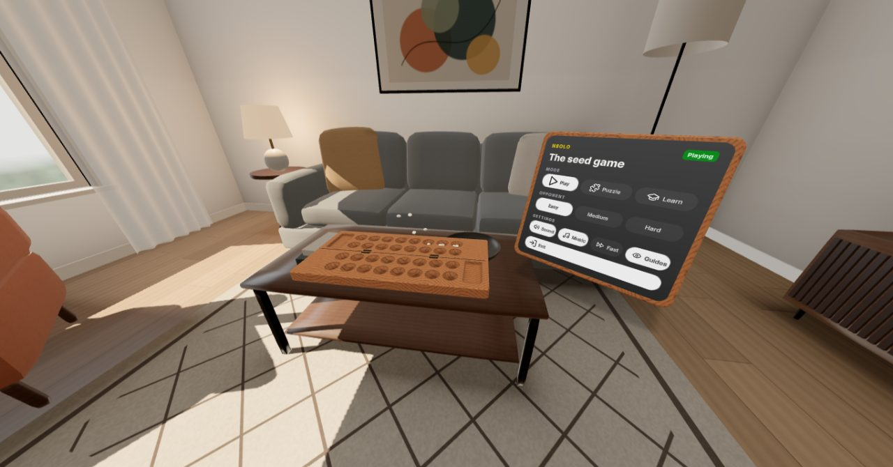
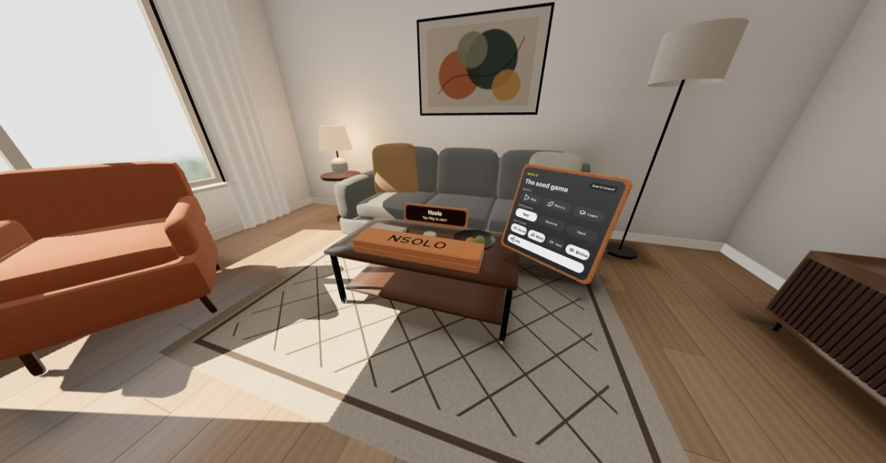
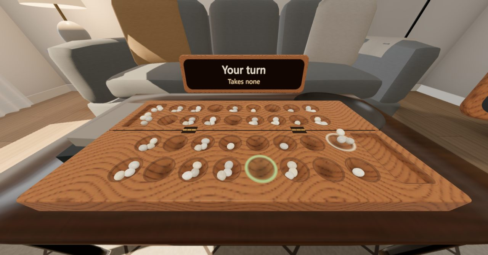
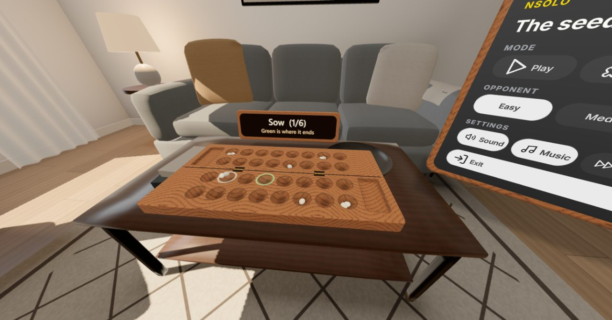
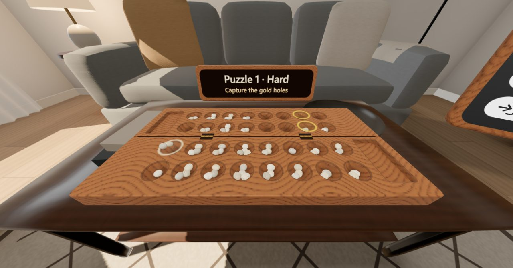

# Nsolo

**Zambia's four-row seed game, on your own table in mixed reality. Played with your hands alone.**

▶ **Play now:** [nsolo.vercel.app](https://nsolo.vercel.app). Open it in the Meta Quest browser and press **Enter XR**.

Nsolo is a mancala game played across Zambia for generations, scratched into the ground or carved into wood, with seeds or small stones. This app puts a wooden Nsolo board on your real table, in passthrough, and lets you play it with your hands: reach out and tap a hole to sow it. You can learn every rule in six voiced lessons, face an opponent from Easy to Hard, and solve puzzles that never run out.

Built with Meta's [Immersive Web SDK](https://iwsdk.dev) for the **2026 Meta VR Start Developer Competition**.

> This repository is the public page for Nsolo: description, screenshots and the live link. The source code is kept private.

## Features

- **Hands only.** Tap a hole with your fingertip to play it, or pinch the menu panel from a distance. No controllers needed, but they work too.
- **On your table.** The board finds a real table in your room, sits on it facing you, unfolds on its hinges, and two seeds drop into every hole.
- **An opponent with three levels:** Easy, Medium and Hard.
- **Learn.** Six short lessons, each with a guided move and a spoken explanation, cover every rule.
- **Puzzles.** "Capture the gold holes in one move", on three ladders: Easy, Medium and Hard. The ladders never run out.
- **Feel.** Recorded stone-on-wood sounds, kalimba music, confetti in the colours of the Zambian flag, and a sign that shows the score and what each move takes.

## Screenshots

| | |
| --- | --- |
|  |  |
| The board arrives closed. Tap Play to open it. | Your turn. The ring shows where your move ends. |
|  |  |
| Lesson 1 of 6: sowing. | Puzzle: capture the gold holes in one move. |

## How to play

Each player owns two rows: a front row (facing the opponent) and a back row, 16 holes in all. The game starts with 2 seeds in every hole.

1. **Sow.** Pick up every seed from one of your holes that has **2 or more** seeds, and drop them one by one around your two rows, counter-clockwise.
2. **Relay.** If your last seed lands on other seeds, pick them all up and keep sowing. One move can chain around the whole board.
3. **Stop.** Your turn ends when your last seed lands in an empty hole.
4. **Capture.** If that empty hole is in your **front row**, and the opponent's front hole facing it has seeds, you capture that hole *and* the one behind it into your store. If their front hole is empty, the hole behind it is safe.
5. **Win.** A player with no hole of 2 or more seeds cannot move and loses at once. Leave your opponent with only single seeds, and you win.

## Requirements

- A Meta Quest headset (Quest 3 recommended for table detection) with its built-in browser.
- It also opens in a desktop browser, but mixed reality and hand play need a headset.

## Credits

- **Seed sounds:** "Marbles bag drop on wood" by Olichite ([Freesound #238886](https://freesound.org/s/238886/)), CC0.
- **Button click:** "click_002" from Kenney's [Interface Sounds](https://kenney.nl/assets/interface-sounds), CC0.
- **Lesson voice:** [Kokoro-82M](https://huggingface.co/hexgrad/Kokoro-82M) ("Heart" voice), Apache 2.0.
- **Built with:** [Immersive Web SDK](https://iwsdk.dev) and [Three.js](https://threejs.org).

Nsolo, the game, is part of Zambia's shared heritage. This app is one way of playing it.

## License

© 2026 Pumulo Mufalali. All rights reserved. The screenshots and text here may be shared to talk about Nsolo, with a link back to this page.
